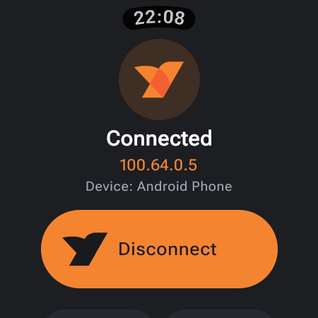
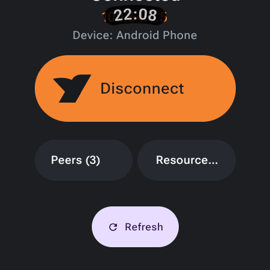
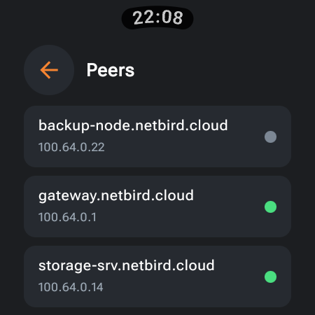
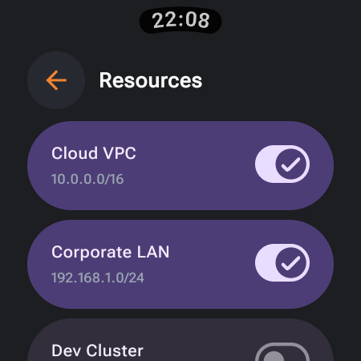

# NetBird Wear

**Unofficial community project. Not affiliated with NetBird GmbH.**

[Releases / APKs](https://github.com/AndrewSpec/netbird-wear/releases) ·
[Licenses](LICENSE) · [Security](SECURITY.md) · [Source and provenance](NOTICE.md)

Control the [NetBird](https://netbird.io) VPN on an Android phone from a **Wear OS**
watch. The watch app displays connection status and provides connect/disconnect
controls, including a Tile for quick access. The project includes the watch app
and a patch for the GPL-licensed Android client. **It does not work with the
unmodified Play Store client.** Public APKs are sideload builds; phone APKs target
ARM64 only. Read the security and licensing notes before installing.

Earlier versions were tested on a Samsung Galaxy Watch 4 paired with a Galaxy
S24 Ultra. **The public 1.0.3/1.0.4 builds have not been physically tested in full.** Historical
device results and the remaining checks are recorded in [the test plan](docs/TESTING.md).

## Screenshots

<p align="center">
  
  
  
  
</p>

## Project layout and publication plan

The current checkout is a **standalone watch project plus an Android-client patch**:

| Component | Location | Purpose |
|---|---|---|
| Wear OS app | [wear/](wear/) | Compose for Wear OS UI, Tile, and status updates through the Wearable Data Layer |
| NetBird Wear Edition | [patches/](patches/) and a separate upstream build tree | Unofficial Android client build with a Wear bridge and a `Binder` connection to `VPNService` |
| Build and installation helpers | [scripts/](scripts/) | Build the Go AAR, apply the patch, build both APKs, and install them |

The planned publication layout is a fork rooted at the Android upstream project:
**the repository root will be the Android client**, and **`wear-os/` will contain
the standalone watch project, its documentation, and its scripts**. The intended
history is a **single customization commit** above pinned Android upstream commit
`ad7865a2c3cc1bc940bf63512ccab1819ebf53a6`. That restructuring has not been applied
here. All commands and paths below are relative to this current standalone project;
they do not assume that it has already moved under `wear-os/`.

> **Why patch the client instead of providing a separate phone companion?**
> The pinned Android client does not expose a supported external connect/disconnect
> API: `VPNService` is not exported, its notification has no connect/disconnect
> actions, and `MainActivity` does not handle those commands. UI automation or
> privileged workarounds do not provide the intended ordinary, screen-off workflow.
> The phone therefore runs an unofficial build of the upstream client with a Wear
> bridge, while the watch runs a separate app. This analysis concerns the pinned
> source, not a claim about every future upstream release. See the
> [architecture plan](docs/PLAN.md) and [patch documentation](docs/NETBIRD_PATCH.md).

## How it works

```text
Watch (Wear OS)                                 Phone (NetBird Wear Edition)
┌──────────────────────┐  Wearable Data Layer  ┌──────────────────────────────┐
│ App + Tile           │ /netbird/command ───▶ │ WearBridgeService            │
│ WearMessageService   │ ◀── /netbird/state    │   └─ Binder → VPNService     │
│ StateStore           │                      │        └─ NetBird Go engine  │
└──────────────────────┘                      └──────────────────────────────┘
```

- **Both APKs must use the same `applicationId` (`io.netbird.client`) and signing
  certificate.** Google Play services identifies Data Layer apps by package and
  signature (AppKey) and routes messages and capabilities only between matching
  apps. The earlier watch package `io.netbird.wear` did not work for this purpose.
- The watch sends `connect`, `disconnect`, `toggle`, or `status`.
- The phone uses the same engine calls as NetBird's Quick Settings Tile:
  `runEngine` and `stopEngine`. It reports `CONNECTED`, `CONNECTING`,
  `DISCONNECTING`, `DISCONNECTED`, `NEEDS_LOGIN`, `NEEDS_SETUP`, `NO_NETWORK`, or `ERROR`.
- When the phone cannot be reached, the watch displays `PHONE_UNAVAILABLE`.

## Watch languages

The watch UI supports **English (`en`), Polish (`pl`), German (`de`), Spanish
(`es`), French (`fr`), Portuguese (`pt`), Italian (`it`), Japanese (`ja`), Korean
(`ko`), and Simplified Chinese (`zh-CN`)**. It automatically follows the watch's
system locale; **English is the fallback** when no supported translation matches.
There is no separate in-app language selector. Project documentation is published
in English; Polish is retained as a UI localization, not as a second documentation
language. Phone-client localization remains the responsibility of the upstream UI.

## Requirements

- **Phone:** Android 8.0+ (`minSdk 26`), ARM64, Google Play services for the Data
  Layer, and a paired Wear OS watch.
- **Watch:** Wear OS 3+ (`minSdk 30`); ADB debugging is needed to sideload the APK.
- **Build environment:** JDK 17, Android SDK 36, Go 1.26+, Android NDK
  23.1.7779620, and several gigabytes of free space for sources, the AAR, and caches.
  The scripts download the pinned NDK if needed; install the JDK, Go, and Android
  SDK separately.

## Build

Run from this standalone project's root:

```bash
./scripts/build-all.sh
```

The first build downloads the upstream source, NDK, and Go/Gradle dependencies and
can take several minutes or longer. Outputs are written to [dist/](dist/):

```text
dist/netbird-wear-release.apk   # Phone: NetBird Wear Edition
dist/netbird-watch-release.apk  # Watch: Wear OS app
dist/netbird-wear-debug.apk     # Debug variants
dist/netbird-watch-debug.apk
```

**The release variants are signed with a local debug/developer key for
sideloading, not an official NetBird production certificate.** Debug variants
provide the same core controls and are debuggable. Preserve your signing key for
future updates, and use the same key for the phone and watch builds.

Individual stages are available through [build-netbird-aar.sh](scripts/build-netbird-aar.sh),
[build-phone-apk.sh](scripts/build-phone-apk.sh),
[build-watch-apk.sh](scripts/build-watch-apk.sh), and
[build-release.sh](scripts/build-release.sh).
[env.sh](scripts/env.sh) defaults `ANDROID_HOME` to `~/Android/Sdk`, derives
`JAVA_HOME` from `javac` when unset, and defaults the build caches and signing
keystore to workspace-local directories. Set `JAVA_HOME` explicitly if the default
compiler is not JDK 17, and set `ANDROID_HOME` if your SDK is elsewhere.

If you already have the required AAR in the upstream clone's
`gomobile/netbird.aar`, you can apply the patch and build there directly:

```bash
./scripts/apply-netbird-patch.sh /path/to/android-client
cd /path/to/android-client
./gradlew :app:assembleDebug
```

Use a clone at the pinned commit. The patch helper refuses incompatible changes
rather than resetting or deleting them; see [the patch guide](docs/NETBIRD_PATCH.md).

## Installation and first run

1. **Back up any settings you need, then uninstall the official NetBird app from
   the phone.** This build uses the same package (`io.netbird.client`) but a
   different certificate and cannot update the official app in place.
   **Uninstalling deletes local configuration**: record your server address and
   be ready to sign in again. Do not uninstall this build for later updates signed
   with the same key; use `adb install -r` instead.
2. Install the phone APK:
   ```bash
   adb -s <PHONE_SERIAL> install -r dist/netbird-wear-release.apk
   ```
3. Open **NetBird** on the phone, sign in or add a profile, and connect manually
   once. Accept Android's VPN consent prompt.
4. **Disable battery optimization for NetBird.** Background connection requests
   on Android 12+ need an exemption from foreground-service start restrictions.
   The settings path is typically Settings → Apps → NetBird → Battery →
   **Unrestricted**; wording varies by device. If the bridge shows a
   “NetBird Wear — allow background control” notification, tap it to open the
   system exemption dialog.
5. Enable wireless ADB debugging on the watch, pair/connect as prompted by the
   device, and install the watch APK:
   ```bash
   adb connect <WATCH_IP>:<PORT>
   # Only if the old, differently packaged watch app is installed:
   adb -s <WATCH_SERIAL> uninstall io.netbird.wear
   adb -s <WATCH_SERIAL> install -r dist/netbird-watch-release.apk
   ```
6. Open **NetBird** on the watch. Add **NetBird VPN** from the watch's Tile list.

The watch app and Tile can now request that the phone connect or disconnect.

## VPN control security

Watch commands use the Wearable Data Layer, scoped to the matching package and
signing certificate. Since 1.0.3, the additional broadcast API is protected by
`io.netbird.client.permission.CONTROL_VPN` with protection level `signature`.
Ordinary apps (including Tasker) and unprivileged ADB commands cannot use it to
toggle the VPN. Status-broadcast recipients also need that permission. Earlier
APKs with the unprotected automation API are not offered as public releases.
See [the security policy](SECURITY.md).

## Limitations

- **Replaces the official phone app.** This is an unofficial sideload build of
  the GPL-licensed client, signed with a local developer key. Updates are manual.
- **Battery-optimization exemption is required for background connection** on
  Android 12+. Without it, a connection request may return `NEEDS_SETUP` and prompt
  for setup. Disconnecting an already running VPN does not require starting a
  foreground service, but still depends on the phone being reachable and working.
- **Initial setup and authentication require the phone**, including VPN consent
  and SSO or a setup key.
- The watch may display cached status after the phone process stops or communication
  is interrupted. Request status again to obtain a fresh response; a displayed
  state is not a guarantee that the remote VPN remains in that state.
- The project inherits the upstream client's platform and network limitations.
  The watch controls the **phone's VPN**; it does not run a VPN on the watch.
- Public builds are unaudited. Historical device testing does not certify the
  current public APKs; see [test coverage and outstanding checks](docs/TESTING.md).

## Troubleshooting

| Symptom | What to check |
|---|---|
| “Phone unavailable” | Open NetBird on the phone after installation, check pairing and Google Play services, and verify that both apps use `io.netbird.client` and the same signing certificate. |
| “Set up NetBird on the phone” | Finish profile setup and sign-in, approve VPN consent, and check the battery-optimization exemption. |
| Connect does nothing or returns a setup warning | Disable battery optimization for NetBird, or tap the bridge's setup notification. Check phone logs if the problem persists. |
| “Login required” | Open NetBird on the phone and sign in again. |
| Tile is missing | Add it manually from the watch's Tile list; check the Wear OS version and that the app is installed for the active watch user. |
| APK update fails with a signature mismatch | Use the original signing key. Reinstalling with another key requires uninstalling first and deletes local app data. |

## Licensing

- The Android-client patch and resulting phone APK are distributed under
  **GPL-3.0**, preserving the license of
  [netbirdio/android-client](https://github.com/netbirdio/android-client).
- The independent Wear OS source in [wear/](wear/) is **Apache-2.0**. Original
  NetBird logo assets copied from the Android client remain under upstream's
  **GPL-3.0** license. The combined watch APK containing those assets is distributed
  under GPL-3.0; the independent source retains its Apache-2.0 license.
- NetBird and its logo belong to their respective trademark owners. This is not
  an official NetBird application. See [the license overview](LICENSE) and
  [provenance notice](NOTICE.md).

## Release history

### First public release: 1.0.3

- Retains the watch controls and visual design developed in 1.0.2.
- Requires the signature-level permission for the additional automation broadcasts.
- The patch helper refuses incompatible trees without resetting or deleting
  changes; the installer requires explicit phone and watch identifiers.
- APKs are release attachments, not Git-history files. Release source archives
  include the modified Android client and pinned Go engine.
- Unaudited sideload build signed with a local developer key; **not physically
  tested as a 1.0.3 APK pair**.

### Watch update: 1.0.2

- Replaced the Tile's round button with a wide switch: orange track and white thumb
  on the right when connected, gray track and thumb on the left when disconnected.
- Kept the logo and status above the switch and the action label below it.
- Historically paired with phone version 1.0.1-wear; this is release history, not a
  recommendation to use older phone APKs without 1.0.3's automation protection.

### Update: 1.0.1

- Fixed immediate phone-screen updates after watch commands by registering the
  bridge as an independent observer instead of replacing `MainActivity`'s listener.
- Added original NetBird branding and orange accents to the watch UI.
- Same-certificate updates with `adb install -r` preserve configuration and sign-in.
